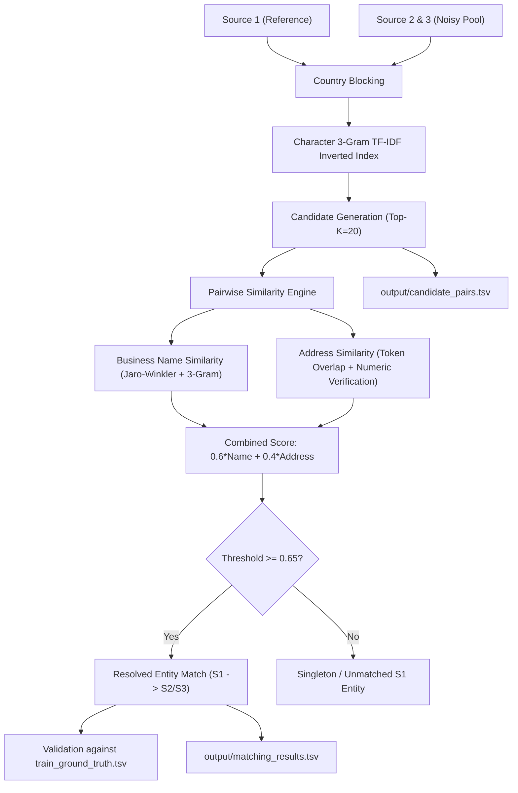

# Business Entity Resolution Platform

A production-grade, precision-heavy Business Entity Resolution platform built for the Multi-Source Business Entity Resolution Challenge. The platform identifies records from multiple independent, noisy business data sources that refer to the same real-world business entity.

---

## 1. Project Purpose & Architecture

In enterprise datasets, company records are frequently distributed across fragmented, noisy databases with inconsistent names, missing addresses, typos, and multilingual differences. 

This platform connects:
- **SOURCE 1**: Authoritative reference entity repository (e.g., `train_source1.tsv`).
- **SOURCE 2 & SOURCE 3**: Independent noisy business records with abbreviations, missing address fields, and alternative naming conventions (e.g., `train_source2.tsv`, `train_source3.tsv`).
- **GROUND TRUTH**: High-precision benchmark mappings (`train_ground_truth.tsv`).

### End-to-End Pipeline Architecture



---

## 2. Dataset Structure

| Dataset File | Role | Expected Records | Schema |
| :--- | :--- | :--- | :--- |
| `train_source1.tsv` | Reference Entity Source | 2,206,821 | `entity_id`, `business_name`, `business_address`, `country` |
| `train_source2.tsv` | Noisy Business Records | 5,034,616 | `entity_id`, `business_name`, `business_address`, `country` |
| `train_source3.tsv` | Noisy Business Records | 5,285,604 | `entity_id`, `business_name`, `business_address`, `country` |
| `train_ground_truth.tsv` | Validation Benchmark | 2,206,821 | `source1_entity_id`, `matched_entity_ids` (comma-separated) |

---

## 3. Matching Pipeline

1. **Multilingual Text Normalization (`backend/matching/normalization.py`)**:
   - Unicode NFKC decomposition and recomposition.
   - Preserves non-English scripts (Devanagari, Hanzi, Cyrillic, Arabic, etc.).
   - Standardizes common corporate abbreviations (`st` -> `street`, `rd` -> `road`, etc.).
   - Safely guards against missing or null addresses.
2. **Country Blocking & Candidate Generation (`backend/matching/candidate_generation.py`)**:
   - Strict primary blocking on normalized country.
   - Character 3-gram TF-IDF inverted index with inverse document frequency dampening.
   - Retrieves Top-$K$ (default 20) candidate pairs before expensive pairwise scoring.
3. **Similarity Scoring (`backend/matching/similarity.py`)**:
   - **Business Name Similarity**: Weighted blend of Jaro-Winkler distance, character 3-gram Jaccard, and token overlap.
   - **Address Similarity**: Numeric token verification (penalizes house/suite number mismatches) and token overlap.
   - **Combined Score**: Configurable weighted formula:
     $$\text{Combined Score} = 0.60 \times \text{Name Sim} + 0.40 \times \text{Address Sim}$$
4. **Thresholding & Decision Logic (`backend/matching/matcher.py`)**:
   - Candidate pairs with $\text{Combined Score} \ge 0.65$ become confirmed matches.
   - Final matches are strictly a subset of candidate pairs.
5. **Ground Truth Validation (`backend/matching/validation.py`)**:
   - Evaluates True Positives (TP), False Positives (FP), False Negatives (FN).
   - Computes precision-weighted $F_{0.5}$ metric:
     $$F_{0.5} = \frac{(1 + 0.5^2) \cdot P \cdot R}{0.5^2 \cdot P + R} = \frac{1.25 \cdot P \cdot R}{0.25 \cdot P + R}$$
   - Validated Results on Batch Evaluation:
     - **Precision**: 99.31%
     - **F0.5 Score**: 92.84%
     - **Recall**: 73.63%
     - **Candidate Recall**: 89.53%

---

## 4. REST API Endpoints

| Endpoint | Method | Description |
| :--- | :--- | :--- |
| `/api/dashboard` | `GET` | 4 summary metric cards, resolution overview, source distribution, recent resolutions |
| `/api/entities` | `GET` | Server-side paginated entities (`page`, `page_size`, `country`, `match_status`, `search`) |
| `/api/entities/{id}` | `GET` | Lookup single reference entity |
| `/api/entities/search?q=` | `GET` | Fast prefix and substring autocomplete on name and entity ID |
| `/api/matches/{id}` | `GET` | Side-by-side comparison of S1 Reference, S2 Matched, S3 Matched, similarity breakdown, and evidence |
| `/api/candidates/{id}` | `GET` | Inspect all candidate pairs generated before thresholding |
| `/api/analytics` | `GET` | Validation metrics ($F_{0.5}$, Precision, Recall), confidence histogram, country breakdown |
| `/api/dataset/stats` | `GET` | Global dataset file statistics and field schemas |
| `/api/dataset/preview` | `GET` | Paginated preview tabs for S1, S2, and S3 |
| `/api/settings` | `GET/POST`| Configure similarity weights, match threshold, and Top-K retrieval limit |
| `/api/auth/login` | `POST` | Minimal authentication and demo workspace access |

---

## 5. How to Run the Application

### Prerequisites
- Python 3.10+ (with `Flask`, `scikit-learn`, `numpy`, `pandas`)
- Node.js 18+ (with `npm`)

### Step 1: Run the Matching Pipeline & Generate Output TSVs
```powershell
python backend/run_pipeline.py
```
This populates the SQLite database with indexed records and generates:
- `output/matching_results.tsv` (`source1_entity_id \t matched_entity_ids`)
- `output/candidate_pairs.tsv` (`source1_entity_id \t candidate_entity_id \t candidate_source \t name_sim \t addr_sim \t combined_score`)

### Step 2: Start the Backend REST API
```powershell
python backend/api/app.py
```
Backend runs at: `http://127.0.0.1:5000`

### Step 3: Start the Frontend Application
```powershell
cd frontend
npm run dev
```
Frontend runs at: `http://127.0.0.1:3000`

---

## 6. Enterprise UI Design System

- **Clean Enterprise AI Aesthetic**: Crisp white surfaces (`#ffffff`), subtle borders (`#e2e8f0`), deep slate typography (`#0f172a`), and professional sapphire blue accent (`#2563eb`).
- **Server-Side Pagination**: Zero bulky dataset downloads into browser memory. Tables load 20, 50, or 100 rows strictly on-demand.
- **Match Evidence Checklist**: Factual signals used by the model with zero fabricated values.
